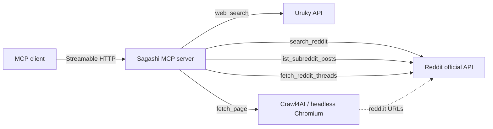

# Sagashi 🔍

**Sagashi is a privacy-focused, self-hostable MCP (Model Context Protocol) server for web search, Reddit search, and page fetching.** It gives MCP-compatible agents (llama.cpp, Claude, Cursor, and others) six tools: web search via the [Uruky](https://uruky.com) API, Reddit search via the official Reddit API, subreddit listing, thread batch fetching, clean Markdown page fetching via [Crawl4AI](https://github.com/unclecode/crawl4ai), and YouTube transcript fetching via [yt-dlp](https://github.com/yt-dlp/yt-dlp). Everything runs on your own host with your own API credentials; no queries or results are stored. The name comes from *sagashi* (捜し, “search”).

AI tools were used during development.

## 🧭 How it works



A single long-lived process serves six tools over Streamable HTTP. Search results are reranked before they reach the agent: when `RERANKER_URL` is set, a llama-server `/v1/rerank` cross-encoder scores each result's title and body against the query; otherwise a built-in lexical term-overlap scorer is used as fallback. Reddit URLs are routed deterministically: `reddit.com` and `redd.it` links are both served through the official API (thread title, selftext, and top comments) — the crawler never touches Reddit (ToS compliance).

### Reddit Tools

Sagashi provides comprehensive Reddit integration via the official API:

- **`search_reddit`**: Search across Reddit (default: r/all) or a specific subreddit with query-based search
- **`list_subreddit_posts`**: Browse posts from a subreddit with sorting and time filtering (supports Matomeru-style rolling 24-hour queries via explicit UTC time windows)
- **`fetch_reddit_threads`**: Efficiently fetch multiple threads in one call with structured data and per-item error handling

All Reddit operations use the official API only — no crawling, ensuring ToS compliance and fresh content.

### YouTube Tool

**`fetch_youtube_transcript`** fetches a YouTube video's title and full transcript by pulling captions through `yt-dlp`. It prefers manual English captions and falls back to auto-generated English; the transcript is plain text with timing/formatting stripped. YouTube bot-checks the server's IP, so a `cookies.txt` file (Netscape format) is required — export it once with a browser extension (e.g. "Get cookies.txt LOCALLY") while signed in to YouTube and mount it into the container at `YOUTUBE_COOKIES_FILE` (see the example compose file).

## 🛠️ Tools

| Tool | Use for | Parameters |
|------|---------|------------|
| `web_search` | General web search queries | `query` (required), `recency` (day/week/month/year) |
| `search_reddit` | Reddit-specific questions or explicit Reddit requests | `query` (required), `time_filter` (day/week/month/year/all, default `month`), `limit` (1–25, default 10), `subreddit` (optional subreddit name) |
| `list_subreddit_posts` | Browse posts from a specific subreddit | `subreddit` (required), `sort` (hot/new/top/rising/controversial, default `hot`), `time_filter` (day/week/month/year/all, default `all`), `limit` (1–100, default 10), `before`/`after` (for pagination/time windows) |
| `fetch_reddit_threads` | Fetch multiple Reddit threads efficiently | `items` (required, list of IDs/URLs), `comment_count` (1–50, default 20) |
| `fetch_page` | Fetching a specific URL | `url` (required), `max_chars` (≥ 1, capped at `FETCH_MAX_CHARS`, default `FETCH_MAX_CHARS`) |
| `fetch_youtube_transcript` | Fetching a YouTube video's title and transcript | `url` (required) |

All tools return compact Markdown sized for agent context windows; large pages are truncated with a visible marker at the configured limit. Parameters are clamped server-side, so agents can freely adjust them.

## 🚀 Quick start

1. Create a Reddit app at [reddit.com/prefs/apps](https://www.reddit.com/prefs/apps) (script type) to get `REDDIT_CLIENT_ID` and `REDDIT_CLIENT_SECRET`. Copy `example.env` to `.env` and fill in the Uruky and Reddit credentials.
2. Start the server:

   ```sh
   uv sync --locked
   uv run sagashi
   ```

3. Point your MCP client at `http://localhost:8000/mcp`. Verify everything works end-to-end with:

   ```sh
   just smoke   # exercises every tool against the running server
   ```

### Docker

Copy `example.env` to `.env` and fill in the required credentials, then start Sagashi with Compose:

```sh
docker compose up -d
```

The example `docker-compose.yaml` uses the published image from `ghcr.io/divin/sagashi`, publishes port `9092` (override with `SAGASHI_PORT`), and checks `GET /healthz` for container health. View logs with `docker compose logs -f sagashi`.

The container runs as a non-root user and includes headless Chromium for page fetching. `GET /healthz` is an unauthenticated health endpoint for container monitoring. The compose file also attaches the container to a shared external `agents` network for multi-service setups; remove the `networks:` blocks for a standalone deployment.

## 🔌 Connecting an MCP client

The server speaks Streamable HTTP and is served under `/mcp`, so the URL to register in any MCP client is:

```sh
http://<host>:<port>/mcp
```

Defaults are `127.0.0.1:8000` locally and `0.0.0.0:3000` in Docker (set via `HOST` and `PORT`). Binding details:

- The container maps `PORT=3000` internally; use `-p <host-port>:3000` to expose it, e.g. `docker run -p 9092:3000 ...` serves `http://<host>:9092/mcp`.
- Browser-based MCP clients connect cross-origin, so the server sends CORS headers. Restrict which origins may call it with `CORS_ORIGINS` (comma-separated, default: allow all — fine for LAN use).

Most clients accept a URL directly, e.g. an `mcpServers` entry:

```json
{
  "mcpServers": {
    "sagashi": {
      "url": "http://192.168.1.10:9092/mcp"
    }
  }
}
```

For clients that can run shell commands but lack native MCP support, the [`fastmcp` CLI](https://gofastmcp.com/docs/cli/client) bridges the gap: `fastmcp list http://<host>:9092/mcp` to inspect tools, `fastmcp call <url> web_search query=test` to invoke them.

## ⚙️ Configuration

| Variable | Required | Description |
|----------|----------|-------------|
| `URUKY_TOKEN` | Yes | Uruky API token for web search |
| `REDDIT_CLIENT_ID` | Yes | Reddit app client ID |
| `REDDIT_CLIENT_SECRET` | Yes | Reddit app client secret |
| `REDDIT_USER_AGENT` | Yes | Reddit app user agent string |
| `MCP_SEARCH_AUTH_TOKEN` | No | Bearer token for MCP access. When set, every request must carry `Authorization: Bearer <token>`; when unset, the server is open (fine for a trusted LAN) |
| `FETCH_MAX_CHARS` | No | Truncation ceiling for page content (default: 40000) |
| `HOST` / `PORT` | No | Bind address (default `127.0.0.1:8000`; Docker sets `0.0.0.0:3000`) |
| `CORS_ORIGINS` | No | Comma-separated browser origins allowed to call the server (default: all) |

Missing required variables abort startup with a clear error; `.env` files are loaded automatically.

## 🔒 Privacy

- **Reddit content only from the official API**: crawling `reddit.com` is hard-blocked to comply with Reddit's Terms of Service and to avoid IP flagging; even if an agent insists, the server refuses. See [ADR 0001](docs/adr/0001-reddit-content-comes-only-from-the-official-api.md).
- **Stateless**: Sagashi is a search proxy. Queries, results, and fetched pages are not stored.
- **Your credentials, your host**: outbound traffic goes only to Uruky, Reddit's API, and the pages you fetch.
- **Optional bearer auth**: set `MCP_SEARCH_AUTH_TOKEN` and the server requires `Authorization: Bearer <token>` on every request; leave it unset for an open server, which is acceptable on a trusted local network. MCP clients pass the header directly (e.g. pi: `pi mcp add search-tools --url http://host:8000/mcp --bearer-token-env-var MCP_SEARCH_AUTH_TOKEN`).

## 🧪 Development

Use Python 3.12, [`uv`](https://github.com/astral-sh/uv), and [`just`](https://just.systems/man/en/):

```sh
uv sync --dev
just       # Format, lint, and sort imports
just check # Type, format, and lint checks
just test  # Test suite
just smoke # Live smoke test against a running server
```

Unit tests mock all network access; the smoke test exercises real endpoints.

## 📦 Releases

Tags trigger the CI pipeline: the `test` job runs checks and tests on every push and pull request, and version tags additionally publish a Docker image to GHCR and create a GitHub Release with generated notes. Check out [Koebako](https://github.com/divin/koebako) and [Koemichi](https://github.com/divin/koemichi) for companion self-hosted projects.

## 🙏 Credits

- [FastMCP](https://github.com/jlowin/fastmcp) for the MCP server framework
- [Crawl4AI](https://github.com/unclecode/crawl4ai) for web crawling
- [asyncpraw](https://github.com/praw-dev/asyncpraw) for Reddit API access
- [Uruky](https://uruky.com) for web search

## 📄 License

Apache License 2.0 — see [LICENSE](LICENSE).
